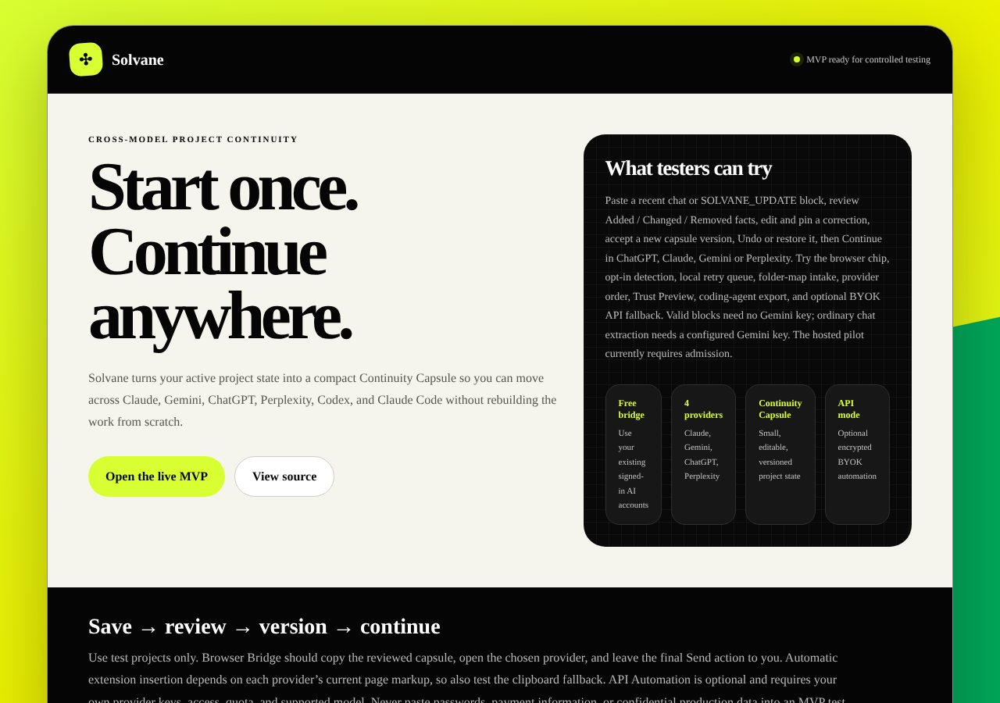

# Solvane

**Start once. Continue anywhere.** Solvane keeps one project memory across Claude, ChatGPT, Gemini and Perplexity. Instead of re-explaining your project every time you switch models, you save a small, reviewable **Continuity Capsule** of where the work stands and carry it to the next model in one click.

**[▶ Open the live pilot](https://solvane.rareyew64.chatgpt.site/)** · [Architecture](docs/01-system-architecture.md) · [Test guide](docs/11-real-world-test-guide.md)

## How it works

1. **Save** — the browser extension captures the useful state of a chat (objective, decisions, constraints, open questions, next step), redacting secrets locally.
2. **Review** — you see a diff of what was added, changed or removed before anything is stored.
3. **Version** — every capsule is versioned, so you can undo or roll back.
4. **Continue** — Solvane opens the next model and inserts the capsule. It never presses Send for you.

## Built with

`TypeScript` · `React 19` · `Vinext` · `Cloudflare Workers` · `D1 (SQLite)` · `Drizzle ORM` · `Tailwind CSS` · `Chrome Extension (Manifest V3)` · `Node test runner` · `Playwright`

## Current product focus

The first live story is deliberately narrower: **work in Claude → save the useful state → review it → continue in ChatGPT**. The app home screen now serves that story directly. Other providers, detailed capsule editing, and API Automation remain available, but are secondary surfaces under Project memory and Advanced. This keeps the first-use experience simple without deleting the underlying platform work.

The product has two complementary modes:

| Mode | For | Cost model | Handoff |
| --- | --- | --- | --- |
| Browser Bridge | Most users | Uses existing signed-in AI accounts; no provider API key | Review capsule, open target model, insert or paste |
| API Automation | Developers and power users | Bring-your-own provider APIs today; managed usage can be added later | Server routing, citations, guarded automatic fallback |

## What the MVP includes

- Account-scoped, cross-device project workspaces backed by D1.
- Editable, versioned Continuity Capsules with objective, current task, decisions, constraints, changes, open questions, do-not-repeat guidance, artifacts, sources, and a locked next step.
- One-click Browser Bridge handoffs to Claude, Gemini, ChatGPT, and Perplexity.
- A Manifest V3 extension that captures visible/selected context, opens the target provider, and inserts the capsule without pressing Send.
- Trust Preview, Context Health, memory-budget estimate, privacy controls, quick capture, handoff history, and capsule rollback.
- Working profile and data center with live account totals, cookie/analytics choices, sign-out, and a complete user-owned JSON export.
- Consent-gated first-party product analytics using a strict event and metadata allowlist; prompt and capsule content is excluded.
- `handoff.md` export for Codex and Claude Code.
- Optional encrypted BYOK API connections, ordered routing, automatic fallback, a developer relay console, persistent messages, and citations.
- Paste-based Checkpoint v1: redact → Gemini/local update-block extraction → reviewable diff → versioned save/undo → existing provider handoff.
- Phase 2 Browser chip: click/`Alt+S` capture on four provider sites, explicit URL-to-project binding, local redaction, in-page diff drawer, ten-second undo, freshness label, and reviewed save-and-continue handoff.
- Phase 3 automation: opt-in stable update-block detection, best-effort limit banners, checkpoint reminders, offline retry queue, API quota failover logs, onboarding/settings controls, privacy-safe metrics, and delete-all data control.

Read [the pilot acceptance workflow](docs/15-pilot-acceptance.md) to test the exact Save → review → version → Continue journey, configure Gemini, and understand the remaining live-provider gate.

## Repository map

| Path | Purpose |
| --- | --- |
| `apps/web` | Authenticated Vinext/React app, Worker APIs, D1 schema, and hosted Site configuration |
| `apps/extension` | Chromium Browser Bridge extension source |
| `apps/web/public/solvane-extension.zip` | Installable MVP extension package generated from `apps/extension` |
| `docs` | Product, architecture, state, API, security, reliability, delivery, and verification documentation |
| `index.html` | Static tester entry page linking to the live product and source |

## Product truth

Solvane preserves explicit working state; it does not copy hidden chain-of-thought, bypass provider limits, or guarantee identical output across models. Browser insertion depends on provider page markup, so clipboard paste remains the supported fallback. API automation remains available for users who need deterministic server-side orchestration.

## Current hosted pilot

- App: <https://solvane.rareyew64.chatgpt.site/>
- Source: <https://github.com/haiderimran019/Solvane>
- Hosted identity and data remain isolated per signed-in user.

ChatGPT is the active Sites-managed sign-in provider. Google and GitHub sign-in are intentionally marked as requiring setup until real OAuth applications, production callback URLs, and secrets are configured; the UI does not pretend those providers are connected.

Start with the [real-world test guide](docs/11-real-world-test-guide.md), the [Phase 1 checkpoint guide](docs/12-checkpoint-phase1.md), the [Phase 2 browser chip guide](docs/13-browser-chip-phase2.md), the [Phase 3 automation guide](docs/14-phase3-automation.md), and [TEST_REPORT.md](TEST_REPORT.md). Then see [implementation status](docs/08-implementation-status.md) for the exact validation boundary before treating a revision as production-ready.
