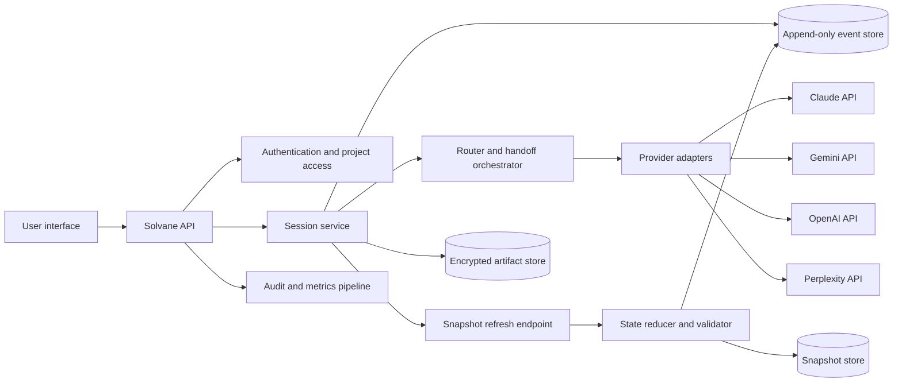
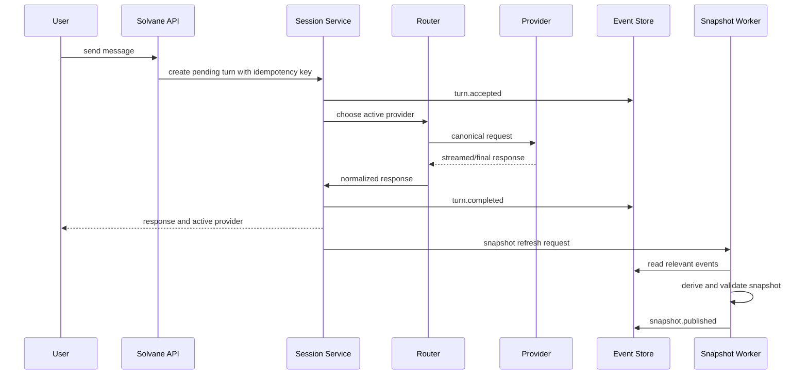

# System Architecture

## 1. Design principles

1. **Solvane owns portable state.** Provider conversation IDs are optimization hints, never the source of truth.
2. **Events are durable; snapshots are derived.** A bad compression result must be repairable.
3. **Provider-specific behavior stays behind adapters.** No provider response shape leaks into project state.
4. **Handoffs are observable and reviewable.** The user can see what was carried forward and why a switch occurred.
5. **Fail safely.** A transient provider failure cannot duplicate a turn or erase the active state.

## 2. Logical architecture

## 3. Components and responsibility

| Component | Responsibility | Does not do |
| --- | --- | --- |
| User interface | Collect input, render conversation, state card, and switch history | Call model providers directly |
| Solvane API | Authenticate requests, apply project authorization, expose lifecycle endpoints | Store provider keys in the browser |
| Session service | Create turns, guarantee ordering, write events, return stable turn states | Generate model content itself |
| Router | Select requested provider or a permitted fallback; apply switch policy | Invent user intent or silently change a chosen model |
| Provider adapter | Translate canonical request/response to one provider API | Mutate canonical project state |
| Snapshot worker | Produce, validate, version, and publish portable state | Delete or rewrite events |
| Event store | Preserve ordered facts and operation outcomes | Serve as a prompt directly |
| Snapshot store | Persist small current and historical state documents | Replace raw evidence |
| Artifact store | Hold encrypted source files or normalized extracts when enabled | Grant providers unrestricted file access |
| Audit/metrics | Capture operational facts with content minimization | Receive raw prompts by default |

## 4. Canonical turn flow

## 5. Handoff flow

A handoff is a new target-provider request; it is not an attempt to make two providers share a native conversation.

1. Lock the project’s active session briefly and select the latest valid snapshot.
2. Add a `handoff.started` event containing the source, target, reason, and snapshot version.
3. Build a target prompt from: stable Solvane system rules, selected snapshot, citation ledger excerpt, and the user’s new message.
4. Send the request through the target adapter with an idempotency key.
5. On success, record `handoff.completed`, set target provider as active, and schedule normal snapshot reduction.
6. On failure, record `handoff.failed`; do not change active-provider state unless another policy-approved attempt succeeds.

## 6. Snapshot lifecycle

The snapshot worker runs after a successful final response and after significant project events such as an explicit decision, a source attachment, or user correction. It produces a candidate snapshot and validates it before publication.

Validation must verify:

- Schema validity and bounded size.
- Required fields are present.
- Referenced source/event IDs exist in the project.
- No secret-looking values are copied into the state card.
- The snapshot is derived from an event range recorded in metadata.

If validation fails, retain the prior valid snapshot and surface the incident internally. Never hand off an unvalidated state document automatically.

## 7. Deployment boundary for MVP

The implemented MVP is one Cloudflare Worker application with authenticated server routes, provider adapters, and a D1 relational database. Snapshot generation is initiated by a separate authenticated request after a completed turn, keeping it outside the critical provider response while avoiding an infrastructure queue during the pilot. Introduce a durable queue only after real traffic proves that disconnected/background execution is necessary.

Required infrastructure:

- D1 relational database for folders, messages, events, snapshots, and encrypted provider configuration.
- Sites authentication headers as the stable per-Site account identity.
- Encrypted object storage only if file/source artifacts are added after the text-first MVP.
- Hosted runtime secrets for the credential-encryption master key and optional platform provider credentials.

## 8. Concurrency and idempotency

- Every send-turn and handoff request carries a client-generated idempotency key.
- Only one active turn may write to a session at a time.
- Provider timeout does not imply the provider did not process the request. Preserve the request correlation ID and resolve uncertainty before retrying where the provider supports it.
- Snapshot publication uses optimistic versioning: a worker may only publish against the event range it reduced.
